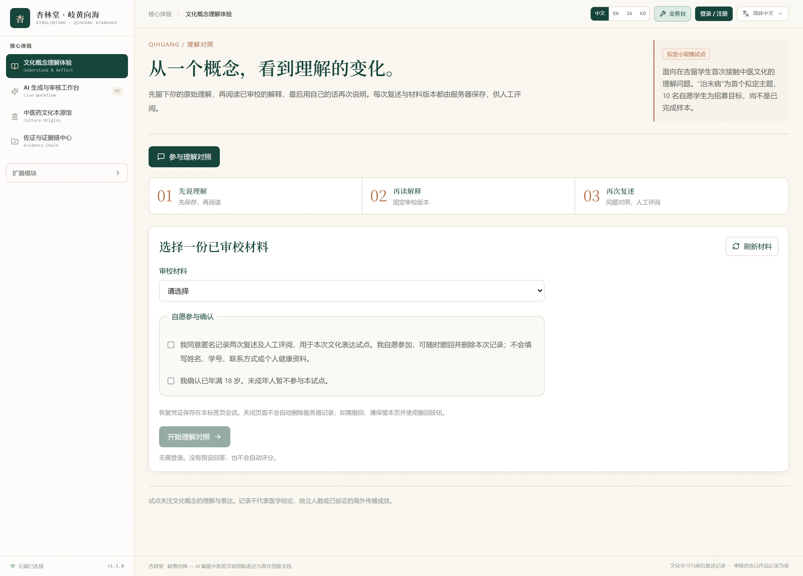
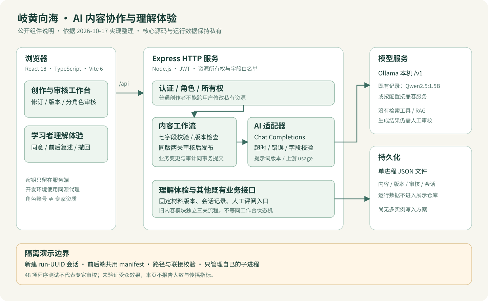

# Qihuang Xianghai

**An AI-assisted editorial workflow for explaining traditional Chinese medicine culture across languages.** [中文](README.md)

The prototype connects a server-side language-model adapter with human editing, role-based review, versioned publication and learner reflection records. Its engineering focus is accountable AI integration: what was generated, which revision was reviewed, who may change it, and how failures are handled.

**The core application remains private. This repository contains only a project description and a UI preview; it cannot run the application and is not a hosted demo.**

*UI screenshot taken in a signed-out state, with no real names or personal data. The in-page "planned pilot" and the "10 volunteers" figure describe a recruitment target, **not a completed sample**. This page does not demonstrate real audience outcomes.*

## Workflow

Topic and target language → model draft → human revision → expert conceptual review → cross-cultural expression review → publication → feedback and before/after reflection records.

- Explanations stay in historical context, word meaning and everyday analogy; a model draft is not a professional conclusion.
- Young creators own topic selection, creative choices and rewriting; the AI supplies candidate text, and sources still require human verification.
- The system stores versions and review records. **A review role on an account does not mean the person behind it holds expert credentials**; demo-account approvals are not real expert opinion.

## Technology

| Part | Technology |
| --- | --- |
| Frontend | React 18 · TypeScript 5 · Vite 6 · Tailwind CSS 4 |
| Backend | Node.js · Express 4 · JWT authentication |
| Storage | Single-process JSON file persistence, suitable for the current prototype; no multi-instance concurrency guarantee |
| Model interface | Server-side OpenAI-compatible Chat Completions; local Ollama via its `/v1` endpoint |

## Implemented engineering work

- **AI integration**: the server calls a model endpoint and fails explicitly when configuration is incomplete, rather than returning template text.
- **Structured drafts**: seven fields — title, body, literal expression, contextual explanation, and cultural/source/risk notes. The Ollama branch requests JSON Schema; server validation is an additional structure check, **not a correctness guarantee**.
- **Traceability**: model, prompt version, request identifier, elapsed time and upstream-reported token usage are recorded. When upstream reports no usage this is marked missing and **never estimated**.
- **Versioning**: edits, reviews, publication and feedback carry `expectedVersion`; missing or malformed returns 400 and stale returns 409. Editing increments the version and invalidates existing approvals.
- **Authorization**: JWT sign-in, role checks, ownership validation for private resources and field allowlists. The main workflow publishes only after two reviews of the same version. The legacy content module keeps a separate three-stage process; **the two are not one state machine**.
- **Write consistency**: business changes and audit records are committed in one transaction; a failed disk write rolls everything back and returns an explicit failure code rather than reporting success.
- **Reflection flow**: informed consent, first response, fixed material version, second response, a human evaluation entry point and withdrawal.

## Measured model call

On 2026-10-17 a real local inference completed through the application's own request path (Ollama / Qwen2.5:1.5b): an English draft about the concept "prevention before illness" (治未病), taking about 15.8 seconds, with upstream-reported usage of 701 input and 306 output tokens.

This demonstrates only that **the call path works**. It does not show that the output is accurate, that the cultural framing has been professionally reviewed, or that any audience outcome was achieved.

## Verification record

2026-10-17: **48/48** backend and safety tests passed, together with type checking, both frontend build modes and a candidate-source snapshot build. Environment: Node.js 24.11.1.

These are program-behaviour checks and **cannot substitute for expert cultural review or participant research**; some cases use simulated HTTP model responses. Retrieval-augmented generation (RAG) is not implemented, and no throughput or concurrency benchmark exists.

## Not included here

Core source code, real `.env` files and credentials, business databases, uploaded attachments, participant responses, interviews and cooperation letters, model weights, LoRA training artefacts, and any screenshot or asset whose publication rights are unconfirmed. Historical synthetic evaluation records are likewise not published here.

Individual and team contribution, awards, intellectual property, partnerships, employment and distribution figures are shown only once backed by verifiable documents; **this page does not present unverified promotional numbers as results**.

## Feedback

Suggestions are welcome through this repository's GitHub Issues. **Please do not include names, contact details, medical records, passwords or API keys.** Feedback is voluntary and is not automatically research participation. GitHub Stars measure repository attention, not adoption, international reach or cultural learning outcomes.

This is a cultural expression and learning prototype, not a clinical diagnostic or treatment product.
