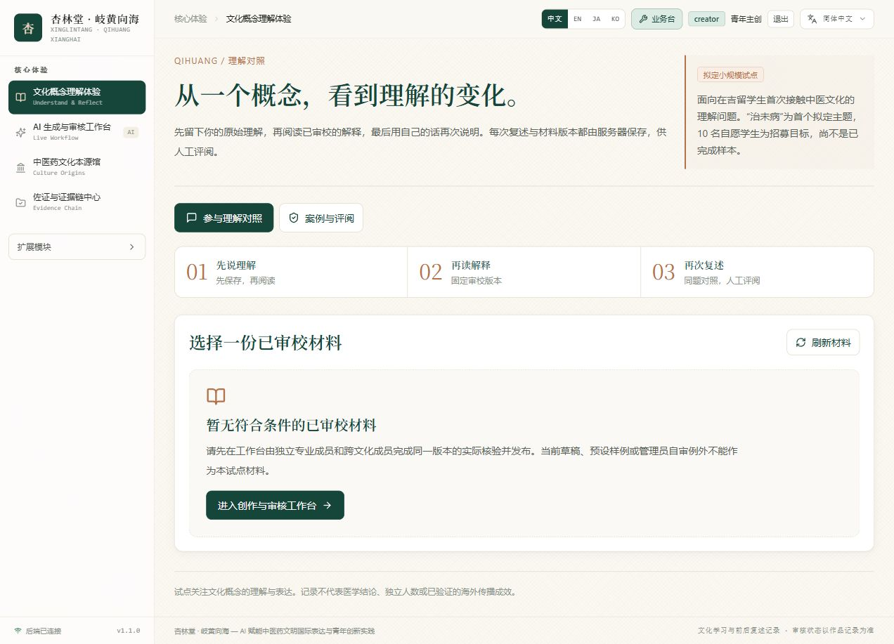

# 岐黄向海

**AI 赋能中医药文明国际表达与青年创新实践 · 项目展示**

探索如何把中医药文化概念讲给首次接触它的学习者，并通过前后复述观察理解的变化。本仓库 `qihuang-ai-showcase` 用于展示项目思路、原型界面与当前进度。

*页面为原型预览，真实文化试点仍在准备。*

## 已实现的原型能力

- **文化表达工作台**：调用真实模型 API 生成初稿，支持标题、正文、字面表达、语境化解释及文化、来源、风险说明共七字段人工修订。
- **审校与发布流程**：支持专业审校、跨文化审校两类人工操作，保留版本记录，并连接发布与反馈。
- **理解体验**：参与者确认同意后，依次提交首次复述、阅读已审校解释、提交再次复述；完整案例由人工评阅。原型支持恢复会话与自愿撤回。

这些流程已在前后端原型中实现。内容是否可靠、学习者是否理解，需要实际审校与试点记录支持。

## 当前进度

截至 **2026 年 10 月 7 日**：

| 项目 | 状态 |
| --- | --- |
| 真实模型调用 | 已调用本地 Qwen2.5:1.5b |
| 代码验证 | 私有源码仓库 CI 已通过 21 项 API 测试、类型检查、普通构建与单文件构建 |
| 正式双审材料 | 0 条；待完成真实专业与跨文化审校 |
| 真实文化试点 | 准备中，尚未在此报告参与人数或理解改善结果 |
| 团队训练记录 | 尚未归档，本页暂不报告训练指标或模型改进结论 |

自动测试验证程序行为，不能代替真实专家审校或参与者研究。项目关注文化表达与理解，不提供临床诊断或疗效承诺。

## 公开范围

核心源码保存在私有仓库。本展示仓库只提供项目说明与页面预览，**无法直接启动网站**。

API 密钥、账户与参与者数据库、模型权重及私有材料不在此公开。公开展示、源码管理、真实试点和网站部署分别记录进度。

## 自愿反馈

欢迎通过 **Issues** 提出界面、表达或可用性建议，请勿填写个人信息或健康隐私。反馈属于自愿交流，不会自动计入正式试点样本。

可以通过 **Star** 关注项目更新。Star 数仅表示 GitHub 仓库关注度，不代表真实用户数、海外传播规模或文化理解效果。
